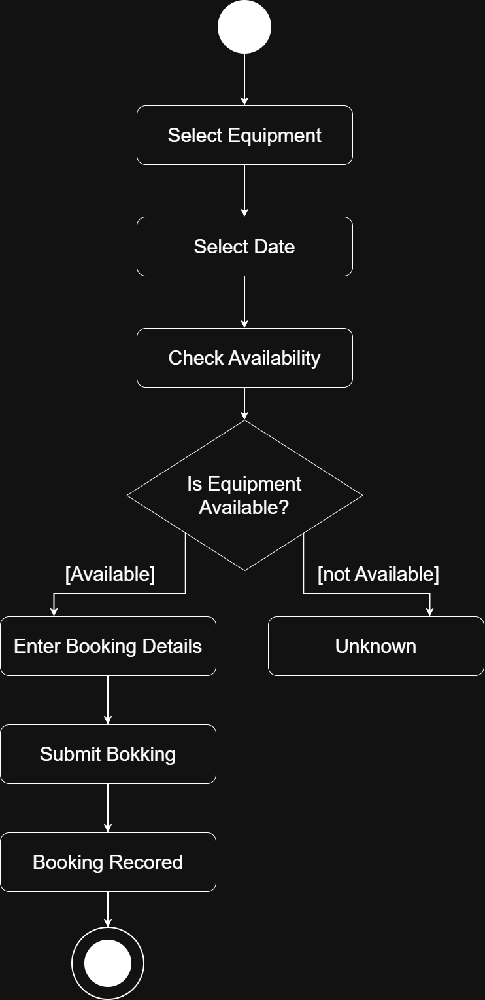

# Week 5 - Activity Diagram

## Contents

1. [Process Modelled](#1-process-modelled)
2. [Purpose](#2-purpose)
3. [Activities](#3-activities)
4. [Decision and Guards](#4-decision-and-guards)
5. [Unknowns](#5-unknowns)
6. [Stakeholder Question](#6-stakeholder-question)
7. [Modelling Decision](#7-modelling-decision)
8. [Reflection](#8-reflection)

*[Back to README](/README.md)*

## 1. Process Modelled

The process modelled is **Create Equipment Booking**. The actor identified is the Student.

## 2. Purpose

The activity diagram shows the main steps and decisions involved in creating an equipment booking. It describes what happens during the process.

## 3. Activities

The supported activities are:

* Select Equipment
* Select Date
* Check Availability
* Enter Booking Details
* Submit Booking
* Booking Recorded

## 4. Decision and Guards

After **Check Availability** the process asks **"Is equipment available?"**

* [Available] - Continue to Enter Booking Details -> Submit Booking -> Booking Recorded
* [not Available] - The process reaches an unknown because the case information does not explain what should happen next.

## 5. Unknowns

The case information does not specify what happens when the requested equipment is unavailable. No solution has been added to the diagram bacause that would introduce an unsupported rule.

## 6. Stakeholder Question

**Question:** What should happen when the requested equipment is unavailable?

**Stakeholder:** A stakeholder responsible for equipment bookings or equipment availability, such as the Equipment Manager or relevant staff member could clarify the rule.

## 7. Modelling Decision

The diagram uses one initial node, activity/action nodes, control-flow arrows, a decision with the guards [Available] and [not Available] and one final node on the successful booking path.

The unavailable path is marked **Unknown** rather than assuming a waiting list/alternative item suggestion/cancellation or any other possible outcome.

## 8. Reflection

An Activity Diagram can reveal the sequence of activities, where a decision changes the process and where requirements are still missing.

We have to avoid inventing what the system should do when the requested item is unavailable.
