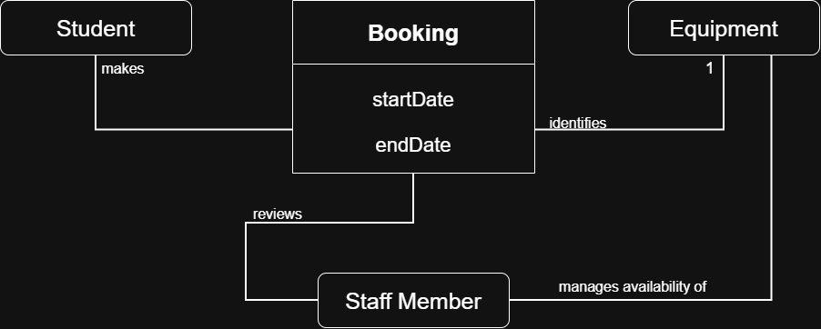
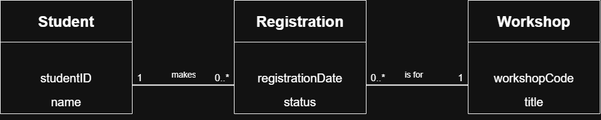

# Week 6 - UML Class Diagrams

## Contents

1. [Domain Concepts](#1-domain-concepts)
2. [Requirements-to-Model Check](#2-requirements-to-model-check)
3. [Multiplicity Justifications](#3-multiplicity-justifications)
4. [Open Questions](#4-open-questions)

*[Back to README](/README.md)*

## 1. Domain Concepts

The College Equipment Booking System has four main domain classes: Student, Booking, Equipment and Staff Member.

| **Candidate concept** | **Type** | **Supporting requirement** |
|---|---|---|
| Student | Class | FR01 |
| Booking | Class | FR01, FR02, FR03, FR06 |
| Equipment | Class | FR02, FR05 |
| Staff Member | Class | FR04, FR05 |
| startDate | Attribute of Booking | FR03 |
| endDate | Attribute of Booking | FR03 |
| Booking approval or rejection | State/decision requiring clarification | FR06 |

### Class descriptions:

* **Student:** makes equipment bookings.
* **Booking:** identifies the equipment item and records its start date and end date.
* **Equipment:** is the item associated with a booking and its availability is managed by staff.
* **Staff Member:** reviews booking requests and manages equipment availability.

### Uncertainty

FR060 states that a booking may be approved or rejected, but the case does not specify how this decision is stored.

## 2. Requirements-to-Model Check

The College Euipment Booking class diagram was checked against six requirements:

| **Requirement** | **What is states** | **How it is represented in the model** |
|---|---|---|
| FR01 | A student can make more than one booking. | Student is associated with booking. |
| FR02 | Each booking identifies exactly one equipment item. | Booking is associated with equipment with multiplicity 1 at the equipment end. |
| FR03 | Each booking records a start date and end date. | startDate and endDate are attributes of Booking. |
| FR04 | Staff members review booking requests. | Staff Member is associated with Booking through the reviews relationship. |
| FR05 | Staff members manage equipment availability. | Staff Member is associated with Equipment through 'manages availability of'. |
| FR06 | A booking may be accapted or rejected. | The decision is identified in the requirements, but the model does not yet represent how the outcome is stored. |

### Equipment Booking Class Diagram

The diagram represents the main concepts and relationships described in the supplied requirements. Some multuiplicities remain unresolved because the case does not provide enough information to justify them.

## 3. Multiplicity Justifications

Multiplicity describes how many instances of one class may be associated with an instace of another class.

### College Equipment Booking System

| **Association** | **Multiplicity** | **Justification** |
|---|---|---|
| Booking - Equipment | '1' at the Equipment end | FR02 states that each booking identifies exactly one equipment item. |
| Student - Booking | Not fully specified | FR01 states that a student can make more than one booking but the case does not specify every multiplicity at both ends. |
| Staff Member - Booking | Not fully specified | FR04 states that staff members review booking requests but the number of staff reviewing each booking is not specified. |
| Staff Member - Equipment | Not fully specified | FR05 states that staff members manage equipment availability but the number of staff members associated with each item is not specified. |

### Workshop Registration

| **Association end** | **Multiplicity** | **Meaning** |
|---|---|---|
| Student end of Student - Registration | '1' | Each registration belongs to exactly one student. |
| Registration end of Student - Workshop | '0..*' | A student may have zero or many registrations. |
| Registration end of Registration - Workshop | '0..*' | A workshop may have zero or many registrations. |
| Workshop end of Registration - Workshop | '1' | Each registration is for exactly one workshop. |

### Workshop Registration Class Diagram

### Modelling Decision

Multiplicities are included only where the supplied requirements justify them. Unsupported multiplicities are left unresolved rather than guessed.

## 4. Open Questions

The following questions require clarification from the relevant stakeholders before the College Equipment Booking Class diagram can be considered complete.

* **Student - Booking:** Is a booking associated with exactly one student? Are zero bookings permitted?

* **Booking - Equipment:** How many bookings may reference the same equipment item over time?

* **Staff Member - Booking:** Is one staff member assigned to review each booking or can several staff members review the same booking?

* **Staff Member - Equipment:** Can several staff members manage the same equipment item?

* **Booking status:** Should the system store an approval decision using a status attribute, and what statuses are required?
